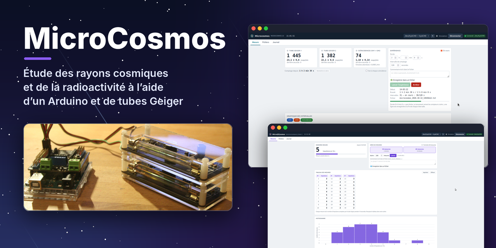

# mucosmos.github.io

Site du projet **MicroCosmos / Micro(K)osmos** : étude des rayons cosmiques et de la radioactivité à l'aide d'un Arduino et de tubes Geiger.

## Structure

| Page | Contenu |
|---|---|
| `index.html` | accueil |
| `logiciel.html` | logiciel Microcosmos, téléchargement (`telechargements/`) |
| `detecteur.html` | matériel, schémas des montages, coïncidence (avec simulateur), détecteurs autonomes |
| `rayons-cosmiques.html` | muons, distribution angulaire, dilatation du temps |
| `radioactivite.html` | potassium 40 et expériences en classe |
| `ressources.html` | articles, TP, diaporamas, masterclass, liens |
| `licence.html` | licence GNU GPL |

Site statique en HTML/CSS (aucune compilation) : `assets/style.css` et `assets/site.js`.
Le fichier `.nojekyll` désactive Jekyll sur GitHub Pages.
Les anciennes adresses (`1microcosmos.html`, `2microkosmos.html`, `tpmoderne.html`, `liens.html`, `GNU-GPL.html`) redirigent vers les nouvelles pages.

Pour mettre à jour le logiciel, remplacer `telechargements/microcosmos.zip` (et les notices PDF) en gardant les mêmes noms.

© Cédric Vanden Driessche, 2024-2026 — licence GNU GPL.
